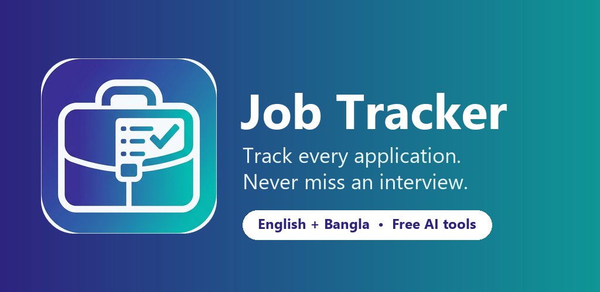
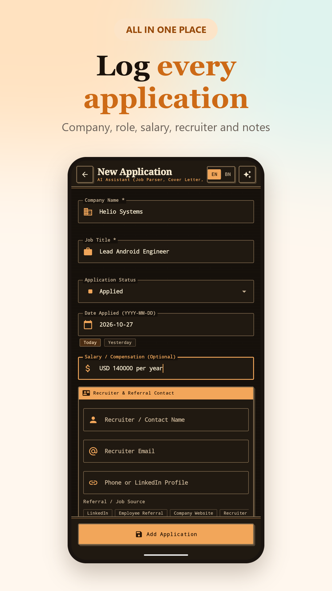
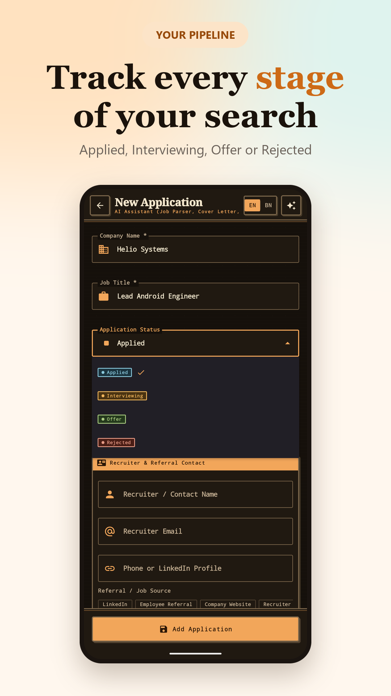
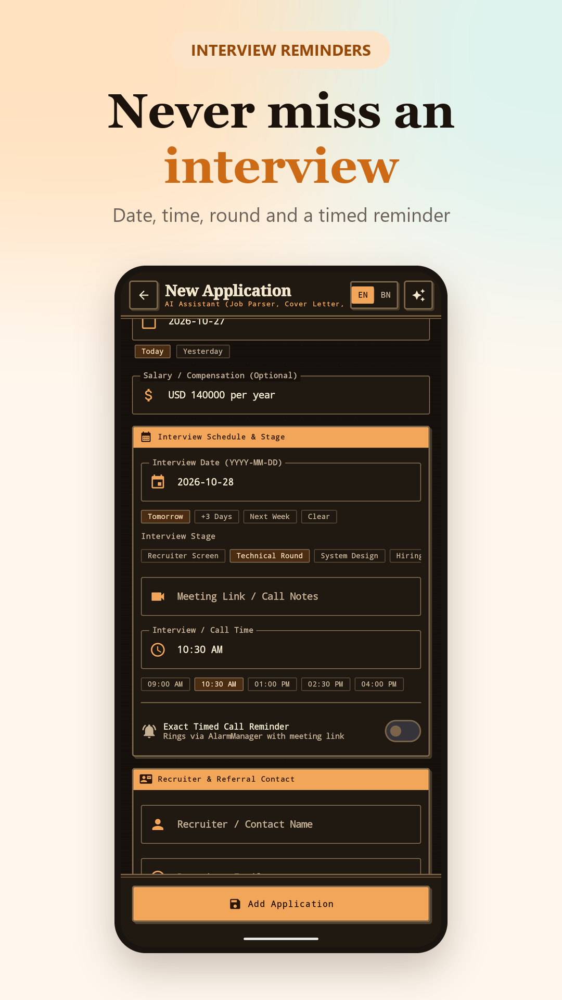
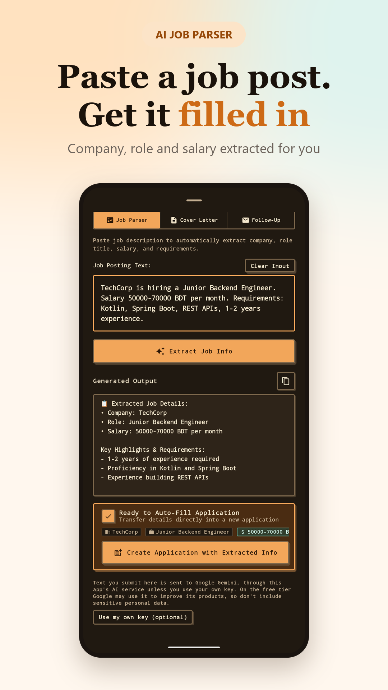
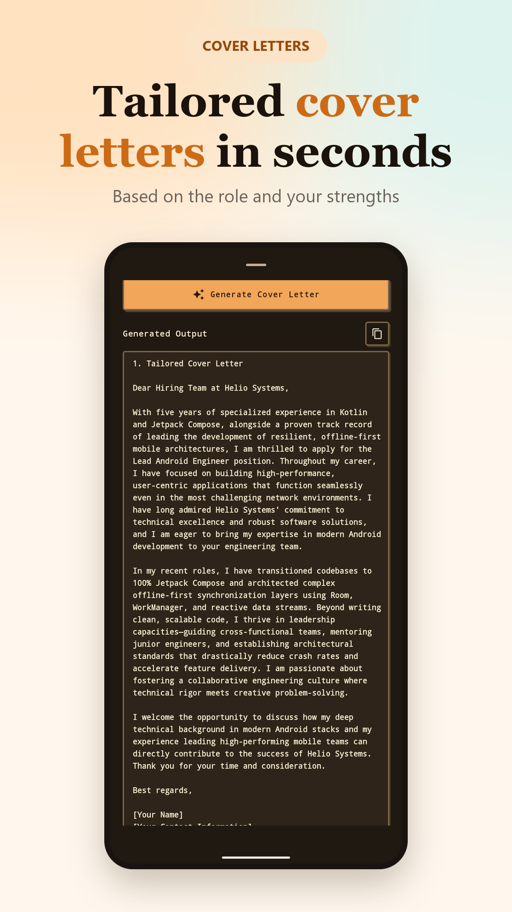
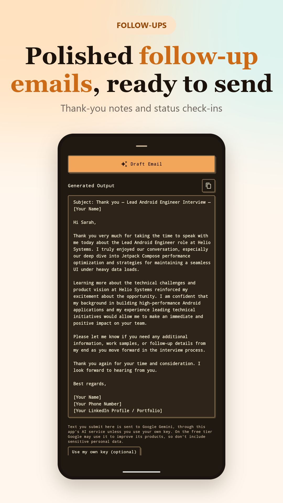
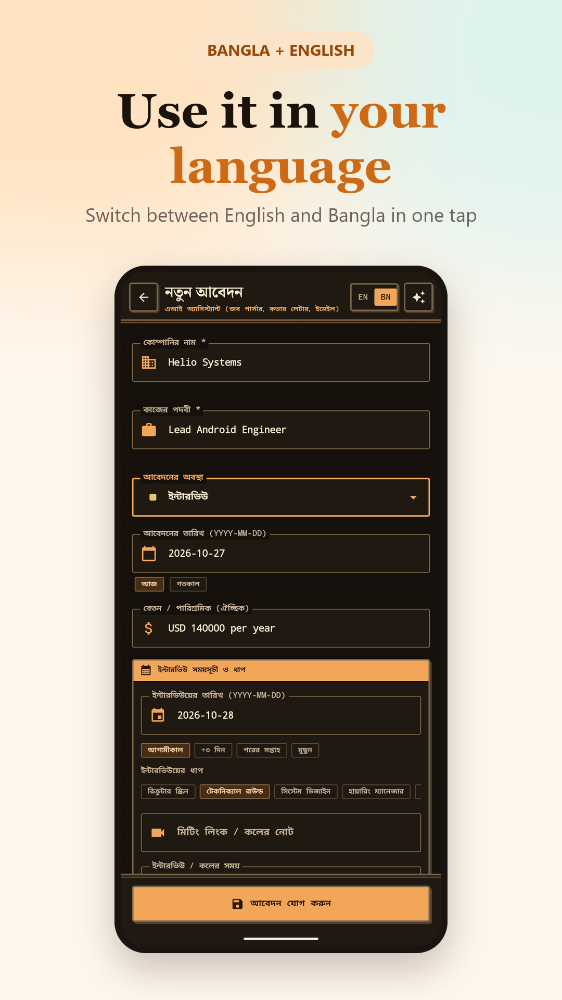
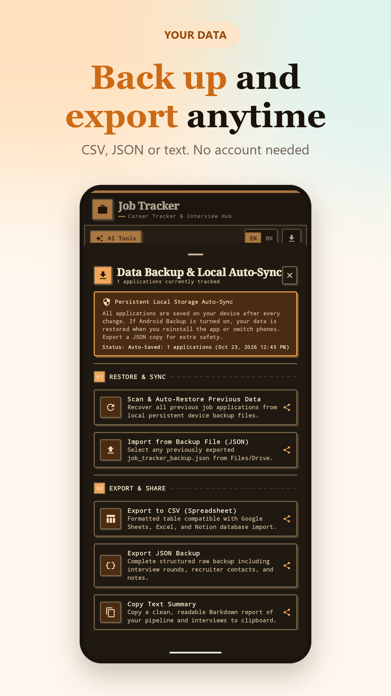

# Job Tracker — Offline-First Job Application Tracker with AI Assistance

<p align="center">
  
</p>

<p align="center">
  
  
  
  
  
</p>

<p align="center"><b>Track every application, never miss an interview — a private, offline-first job search companion with English and Bangla UI.</b></p>

<p align="center">Pipeline • Interview reminders • AI job parser • Cover letters • Follow-up emails • Offer comparison • Insights • Backup & export • Home-screen widget</p>

---

## Table of Contents

- [About the Project](#about-the-project)
- [Why I Built It](#why-i-built-it)
- [Who Will Use It](#who-will-use-it)
- [Why They Will Use It](#why-they-will-use-it)
- [Key Features](#key-features)
- [Screenshots](#screenshots)
- [Tech Stack](#tech-stack)
- [Architecture Overview](#architecture-overview)
- [Getting Started](#getting-started)
- [AI Configuration](#ai-configuration)
- [Building a Signed Release](#building-a-signed-release)
- [Permissions & Privacy](#permissions--privacy)
- [Project Structure](#project-structure)
- [Roadmap](#roadmap)
- [Contributing](#contributing)
- [License](#license)
- [Author & Contact](#author--contact)

---

## About the Project

**Job Tracker** is a native Android app for people who are applying to many jobs at once. It keeps every application, recruiter, interview and offer in one place on your phone, works fully offline, and adds optional AI tools that turn a pasted job post into a filled-in application, a cover letter or a follow-up email.

> Log applications, move them through a pipeline (Applied, Interviewing, Offer, Rejected), set exact interview reminders, compare offers, see how your search is going, and back everything up as JSON, CSV or Markdown.

Built with **Kotlin + Jetpack Compose (Material 3)**, a **Room** database, **AlarmManager exact alarms** for reminders, on-device **ML Kit OCR** for screenshots, and **Google Gemini** for the AI tools through a small Cloudflare Worker proxy so no API key ships inside the APK.

Package: `com.aistudio.jobtracker.app` • Min SDK 24 • Target SDK 36

---

## Why I Built It

Job hunting turns into a mess quickly: a spreadsheet for applications, screenshots of job posts, a calendar for interviews, and half-remembered follow-ups. I wanted one calm place for all of it.

1. **Scattered information:** Company, role, salary, recruiter, referral source and notes usually live in five different places. Here they live in one record.
2. **Missed follow-ups and interviews:** A reminder that actually rings at the right time, and a nudge for applications that have gone quiet, matter more than a pretty list.
3. **Typing the same details again:** Pasting a job post, or even a screenshot of one, and getting the fields filled in saves real time when you apply to dozens of roles.
4. **Privacy:** Your search is personal. Data stays on the device, screenshots are read on the device, and AI is optional.
5. **Bangla-first users:** Many job seekers in Bangladesh prefer a Bangla interface, so the whole UI switches between English and Bangla with one tap.

It is also a production-minded Android project: layered architecture, Room migrations, exact alarms, a widget, on-device OCR, unit tests and a rate-limited AI proxy.

---

## Who Will Use It

- **Job seekers** applying to many roles at the same time.
- **Fresh graduates and career switchers** who need structure and templates for cover letters and follow-ups.
- **Bangla-speaking users** who want a Bangla interface for tracking their search.
- **Anyone comparing offers** who wants salary, benefits and pros and cons side by side.
- **Privacy-minded users** who prefer an offline tracker over a web service.

---

## Why They Will Use It

- **One record per application:** company, title, status, salary, recruiter contact, referral source, notes, interview details and offer details.
- **Reminders that work:** exact alarm reminders for interviews, rescheduled after a reboot.
- **AI that saves typing:** paste a job post or import a screenshot, review the extracted fields, create the application in one tap.
- **Know how your search is going:** interview rate, response rate, offer rate and how each source performs.
- **Safe by default:** local database, automatic local backup, and a restore that recovers your data if the database is ever empty.
- **No ads, no analytics SDKs:** the dependency list contains neither.

---

## Key Features

### 1. Dashboard & Pipeline
- Status summary cards with counts for Applied, Interviewing, Offer, Rejected and saved drafts
- Search your applications and sort by newest, oldest, company (A-Z) or title (A-Z)
- Upcoming interviews card
- Job cards with status color, date and quick details
- Unfinished new applications are saved as drafts so nothing is lost

### 2. Application Details
- Company, job title, date applied (with Today / Yesterday shortcuts), status
- Salary / compensation, work model (Remote, Hybrid, Onsite)
- Recruiter name, email, phone or LinkedIn profile, and referral source
- Notes, plus interview preparation fields (likely questions, STAR stories, negotiation points)

### 3. Interview Reminders
- Interview date, time, stage (recruiter screen, technical round, system design, hiring manager and more) and meeting link or call notes
- Optional **exact timed reminder** through AlarmManager, with a notification and the meeting link
- Reminders are re-armed after a device reboot
- Add the interview to your calendar

### 4. AI Tools (Gemini)
- **Job Parser:** paste a job post and get company, role, salary and key requirements, then create the application with the extracted details
- **Cover Letter:** generate a cover letter from the role and your details
- **Follow-Up Email:** draft a polite follow-up email; the app remembers when you last drafted one
- Works through the app's AI service, or with **your own Gemini key** entered in the app

### 5. Import From a Screenshot (on-device OCR)
- Read the text out of a job-post screenshot or photo with ML Kit text recognition
- The image never leaves your device; only the extracted text can be sent to the AI parser

### 6. Insights & Offer Comparison
- **Insights:** total applications, last 7 and 30 days, interview rate, response rate, offer rate, average days to first interview, and a per-source breakdown
- **Offer comparison:** compare up to three offers side by side with total compensation, a benefits checklist (health, equity, retirement fund, bonus, paid leave, learning budget, flexible hours), pros and cons

### 7. Backup & Export
- Automatic local JSON backup, with auto-restore when the database is empty
- Restore from a JSON file you choose
- Export as CSV, JSON or a Markdown summary; share or copy to the clipboard

### 8. Home-Screen Widget (4x2)
- Your next upcoming interview with a live countdown
- Applied / Interviewing / Offer counts and how many applications are due a follow-up
- Tap to open the app

### 9. Bangla / English
- One-tap EN / BN toggle across the whole interface
- Retro, terminal-inspired dark theme

---

## Screenshots

<p align="center">
  
  
  
  
</p>

<p align="center">
  
  
  
  
</p>

<p align="center"><i>Log applications • Pipeline • Interview reminders • AI job parser • Cover letter • Follow-up • Bangla / English • Backup & export</i></p>

<p align="center"><sub>Screenshots use sample data.</sub></p>

---

## Tech Stack

**Language & UI:**
- Kotlin 2.2.10, Jetpack Compose (BOM 2026.09.00), Material 3, Navigation Compose 2.10.2

**Data & architecture:**
- Room 2.8.5 (KSP), schema version 4 with explicit migrations and exported schemas
- Kotlin Coroutines 1.11.0 and Flow, ViewModel + UI state, manual dependency container (`AppContainer`)

**AI & ML:**
- Google Gemini (2.5 Flash with Flash-Lite and `-latest` fallbacks) through a Cloudflare Worker proxy, or the user's own key
- ML Kit Text Recognition 16.0.1 (on-device OCR)

**Networking:**
- OkHttp 5.5.1

**System:**
- AlarmManager exact alarms, Notification channels, AppWidget (RemoteViews), BootCompletedReceiver

**Build & quality:**
- Gradle 9.3.1, Android Gradle Plugin 9.1.1, compileSdk 37
- JUnit, Robolectric 4.16.1, Roborazzi, Turbine, Mockito-Kotlin and Compose UI tests

See `gradle/libs.versions.toml` and `app/build.gradle.kts` for exact versions.

---

## Architecture Overview

Single-module app that follows a layered, MVVM-style structure:

- `data/` — Room database, DAO and entity (`data/local`), Gemini client and API-key store (`data/remote`), mappers and the repository implementation
- `domain/` — models (`JobApplication`, `JobStatus`, offer benefits), repository interface, use cases, and analytics (`PipelineInsights`, `UpcomingInterviews`, `WidgetSnapshot`)
- `presentation/` — Compose screens and view models for the dashboard, add/edit form, AI tools sheet, insights, offer comparison and export/backup
- `receiver/` and `widget/` — interview reminder and boot receivers, plus the home-screen widget provider
- `util/` — exports, local auto-backup, drafts, notifications, language handling, on-device image text reader
- `localization/` — English and Bangla strings
- `ai-proxy/` — a small Cloudflare Worker that holds the Gemini key server-side

Data flow: **Compose UI → ViewModel → use case → repository → Room / Gemini**, with analytics computed from the stored applications.

---

## Getting Started

### Prerequisites

- [Android Studio](https://developer.android.com/studio) (current stable release recommended) with a JDK 17 or newer
- Android SDK Platform 37
- An Android device or emulator on Android 7.0 (API 24) or newer

### Run Locally

1. Clone the repo:
   ```bash
   git clone https://github.com/InfinityAbir/JobTracker.git
   ```
2. Open the folder in Android Studio and let Gradle sync.
3. Run on an emulator or a physical device. Debug builds work out of the box: they use `debug.keystore` at the project root when present, otherwise the standard Android debug keystore.
4. Optionally configure the AI tools, see below. Everything else works offline.

To install a second copy next to another build, pass `-PdebugAppIdSuffix=.dev`.

---

## AI Configuration

No API key is compiled into the app. There are two ways to use the AI tools:

1. **Your own key (simplest):** get a free Gemini key from [Google AI Studio](https://aistudio.google.com/apikey) and paste it in the app's AI sheet. It is stored only on your device.
2. **Shared AI service:** deploy the Cloudflare Worker in [`ai-proxy/`](ai-proxy/README.md), which holds the key, rate-limits per device and per IP, caps input size and falls back across Gemini models. Put its URL in `gradle.properties`:
   ```properties
   aiProxyUrl=https://job-tracker-ai.<your-subdomain>.workers.dev
   ```
   Leave it empty to disable the shared service so the app only offers the own-key option.

`feedbackEmail` in `gradle.properties` sets where the in-app tester feedback button sends mail.

> If you fork this project, replace `aiProxyUrl` and `feedbackEmail` with your own values.

---

## Building a Signed Release

Release builds need your own upload keystore, which is never stored in the repo. Provide it through environment variables:

```bash
export KEYSTORE_PATH="/path/to/your-upload-key.jks"
export STORE_PASSWORD="your-keystore-password"
export KEY_PASSWORD="your-key-password"

# Android App Bundle (recommended for Google Play)
./gradlew bundleRelease

# Or an APK
./gradlew assembleRelease
```

Output: `app/build/outputs/bundle/release/` or `app/build/outputs/apk/release/`.

The build refuses to produce a release signed with the debug key. Pass `-PallowDebugSignedRelease=true` only for local smoke tests of the shrunk build. Android Studio's **Generate Signed App Bundle** wizard also works.

`bump-version.ps1` and `bump-version.bat` raise the version code and name.

---

## Permissions & Privacy

| Permission | Why |
|---|---|
| `INTERNET` | Call the AI service (only when you use the AI tools) |
| `POST_NOTIFICATIONS` | Interview reminder notifications |
| `SCHEDULE_EXACT_ALARM` | Exact interview reminders |
| `RECEIVE_BOOT_COMPLETED` | Re-arm reminders after a reboot |
| `VIBRATE` | Reminder vibration |

- Applications are stored in a local Room database on your device.
- Screenshots are read on the device. Only text you choose to submit to the AI tools leaves the phone.
- On the free Gemini tier Google may use submitted text to improve its products, so avoid sensitive personal data in AI inputs. The app shows this notice next to the AI tools.
- No ads, no analytics, no crash-reporting SDKs.

---

## Project Structure

```
JobTracker/
├── app/
│   ├── build.gradle.kts
│   └── src/
│       ├── main/java/com/example/
│       │   ├── JobTrackerApp.kt, MainActivity.kt
│       │   ├── data/        (local Room, remote Gemini, repository)
│       │   ├── domain/      (models, use cases, analytics)
│       │   ├── presentation/ (dashboard, detail, ai, insights, offers, export)
│       │   ├── receiver/    (interview reminders, boot)
│       │   ├── widget/      (home-screen widget)
│       │   ├── util/        (export, backup, drafts, OCR, notifications)
│       │   ├── localization/ (English / Bangla strings)
│       │   └── ui/theme/
│       ├── test/            (unit and Robolectric tests)
│       └── androidTest/
├── ai-proxy/                (Cloudflare Worker for the Gemini key)
├── store-assets/            (screenshots, icon and feature graphic)
├── gradle/libs.versions.toml
├── bump-version.ps1 / bump-version.bat
├── build.gradle.kts
├── settings.gradle.kts
└── README.md
```

---

## Roadmap

- [ ] Optional cloud backup and sync
- [ ] Kanban-style pipeline board
- [ ] Contact and company notes across applications
- [ ] Salary calculator and currency conversion for offers
- [ ] Play Integrity attestation for the AI proxy
- [ ] More languages

Contributions and issue reports are welcome.

---

## Contributing

1. Fork the repo
2. Create a feature branch: `git checkout -b feature/your-feature`
3. Commit: `git commit -m "Add your feature"`
4. Push and open a Pull Request

Please add a migration for any Room schema change, keep both English and Bangla strings in sync, and never commit keystores, `.env` files or API keys.

---

## License

This project is currently **All Rights Reserved** — source available for learning and review.

If you want to reuse code or contribute a licensed fork, please contact the author. A formal open-source license (for example MIT) can be added on request.

---

## Author & Contact

**Abir Hasan (InfinityAbir)** — ASP.NET Core / Android developer, building clean, secure, real-world apps.

- GitHub: https://github.com/InfinityAbir
- Portfolio: https://infinityabir.github.io/abir-hasan-portfolio/
- LinkedIn: https://www.linkedin.com/in/infinityabirhasan/

> If Job Tracker helps your job search, please ⭐ star the repo and share feedback via Issues.
